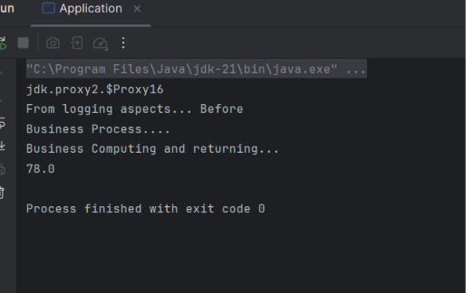
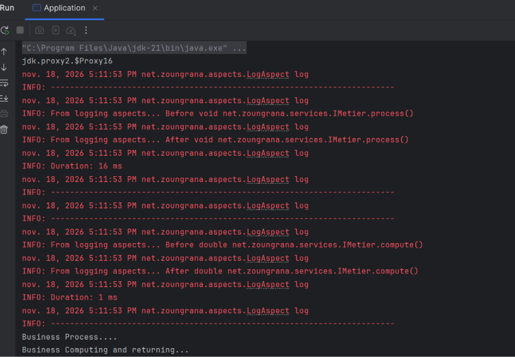
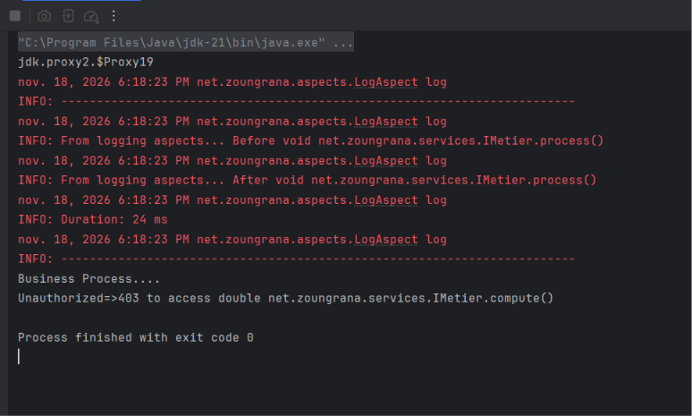

# TP sur la programmation orientée aspect avec Spring AOP

**Compte rendu** · Java 21 · Maven · Spring Framework 7.0.9

## Objectif du TP

Ce TP met en œuvre la programmation orientée aspect dans une application Spring lancée en console. La journalisation et le contrôle d’accès sont définis dans des aspects distincts, tandis que le service métier expose deux opérations, `process()` et `compute()`. Cette séparation permet de faire évoluer la sélection des méthodes journalisées et les règles d’accès à partir de leurs annotations.

Un **pointcut** sélectionne les exécutions de méthodes visées. Un **advice** contient le code à exécuter à ces points. Dans ce projet, Spring applique les advice au moyen d’un **proxy** autour du bean métier. L’appel doit passer par ce proxy pour être intercepté.

## 1. Première interception et observation du proxy

[`Application`](src/main/java/net/zoungrana/Application.java) crée un contexte Spring avec `AnnotationConfigApplicationContext` et récupère le service par son interface `IMetier`. L’implémentation [`MetierImpl`](src/main/java/net/zoungrana/services/MetierImpl.java) est découverte par le scan des composants grâce à `@Service`. L’annotation `@EnableAspectJAutoProxy` active la création des proxies nécessaires aux aspects.

Lors de la première étape (`527e89b`), un advice `@Before` sélectionne `process()` avec `execution(public void process())`. Il affiche un message juste avant le traitement métier. La classe affichée, `jdk.proxy2.$Proxy16`, confirme que l’application utilise un proxy JDK. Dans cette version, `compute()` s’exécute également et renvoie `78.0`.



*Figure 1 — Le message de l’aspect précède l’appel à `process()`. Le nom du proxy apparaît en première ligne de la sortie de l’application.*

## 2. Journalisation et mesure du temps d’exécution

Le premier message console a évolué vers une journalisation avec `java.util.logging.Logger` (`a27ccf0`). L’annotation personnalisée [`@Log`](src/main/java/net/zoungrana/aspects/Log.java), disponible à l’exécution, permet ensuite de marquer les méthodes à journaliser (`d66b264`).

[`LogAspect`](src/main/java/net/zoungrana/aspects/LogAspect.java) utilise le pointcut suivant dans son advice `@Around` :

```java
@Around("@annotation(net.zoungrana.aspects.Log)")
```

L’advice relève l’heure de début, journalise la signature de la méthode puis transmet l’appel avec `proceed()`. Si l’appel se termine normalement, l’advice journalise la fin de l’exécution et la durée mesurée en millisecondes, puis renvoie le résultat. Les deux méthodes du service portent `@Log`.



*Figure 2 — La console affiche les traces de début et de fin pour `process()` et `compute()`, avec leurs durées respectives de 16 ms et 1 ms pour cette exécution.*

## 3. Autorisation par rôle

L’annotation [`@SecuredByAspect`](src/main/java/net/zoungrana/aspects/SecuredByAspect.java) indique les rôles autorisés sur chaque méthode. [`AuthorizationAspect`](src/main/java/net/zoungrana/aspects/AuthorizationAspect.java) récupère cette annotation avec `@annotation(securedByAspect)` et consulte le [`SecurityContext`](src/main/java/net/zoungrana/services/SecurityContext.java) de démonstration (`1a1c56a`). Si l’utilisateur possède au moins un rôle demandé, l’advice appelle `proceed()`. Sinon, il lève une exception que l’application intercepte et affiche dans la console.

| Méthode | Rôles acceptés | Résultat pour le rôle `USER` |
| --- | --- | --- |
| `process()` | `ADMIN` ou `USER` | Le traitement métier s’exécute. |
| `compute()` | `ADMIN` | L’accès est refusé avant le calcul. |



*Figure 3 — Avec le rôle `USER`, `process()` s’exécute et `compute()` est bloquée. Le texte « Unauthorized=>403 » est le message de l’exception dans cette application console.*

## 4. Reproduire la démonstration

1. Importer le [`pom.xml`](pom.xml) comme projet Maven dans IntelliJ IDEA et sélectionner le **JDK 21**.
2. Recharger les dépendances Maven puis exécuter `net.zoungrana.Application`.
3. Vérifier dans la console le nom du proxy JDK, les traces de `process()` et le refus d’accès à `compute()`. Le scénario fourni attribue le rôle `USER` au démarrage.

## Conclusion

Le TP montre comment un appel à un bean Spring peut être journalisé ou bloqué selon les annotations de la méthode. La première interception a rendu le proxy visible. La journalisation sélective a ensuite permis de suivre les appels et leur durée, tandis que `@SecuredByAspect` a rendu les droits d’accès lisibles dans le service. L’appel à `proceed()` relie ces deux usages. Il permet de transmettre l’appel du proxy au traitement métier après la vérification du rôle et de récupérer le résultat pour terminer la journalisation.
